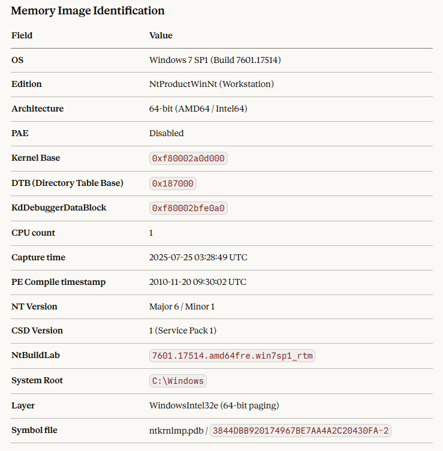
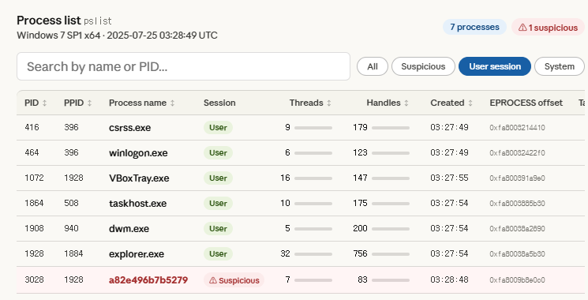
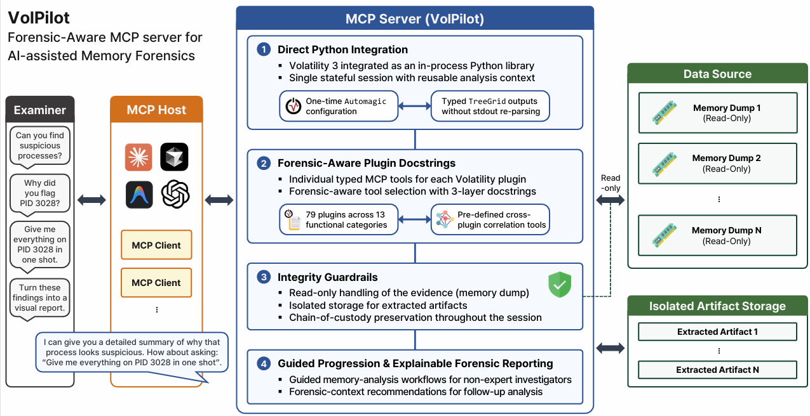

# VolPilot

VolPilot is an MCP server for conversational Windows memory forensics, powered by [Volatility 3](https://github.com/volatilityfoundation/volatility3). Connect it to an MCP-compatible assistant to inspect processes, network connections, registry artifacts, and suspicious activity using natural-language questions.

**Windows memory images only.** The server can run on a compatible Python host; the supported evidence images are Windows images.

## Key Features

- **Broad plugin coverage:** dedicated tools for 88 canonical Windows plugins, with optional dependencies required for nine of them.
- **Forensic guidance:** tool descriptions explain when to use a plugin, its parameters, and relevant Windows-version requirements.
- **Structured results:** direct Python integration returns structured plugin output and reuses an analysis session across calls.
- **Cross-plugin analysis:** seven tools combine process, module, network, service, and timeline evidence.
- **Evidence integrity checks:** one image is bound to each server session; SHA-256 can be checked before and after analysis. Extracted files go to a configured output directory. See [RQ4](evaluation/rq4/rq4.md) for the tested protection scope.

## Installation

Install [uv](https://docs.astral.sh/uv/getting-started/installation/) and Git. The project requires Python 3.10 or later; the following commands select Python 3.12 and install the locked dependencies, including **Volatility 3 v2.28.0**.

```bash
git clone <repository-url> VolPilot
cd VolPilot
uv sync --frozen --python 3.12
```

For all 88 Windows plugin tools, install the optional dependencies:

```bash
uv sync --frozen --python 3.12 --extra full
```

The default installation exposes 87 MCP tools; the full installation exposes 96. The extra includes YARA, PyCryptodome, and other Volatility dependencies. Native-package installation requirements depend on the host platform. See [TOOL_CATALOG.md](TOOL_CATALOG.md) for the nine optional tools.

Supply your own Windows memory image; images and malware samples are not included. Initial analysis may download matching Windows symbols.

## Usage

Configure these environment variables on the machine running VolPilot:

| Variable | Purpose |
|---|---|
| `VOL_IMAGE_PATH` | Required. Absolute path to an existing Windows memory image. |
| `VOL_DUMP_DIR` | Optional. Absolute directory for extracted files. Required when using dump tools. |

The image is fixed when the server starts. Restart the server to analyze another image. The output directory is created during initialization when configured; existing output filenames receive a numeric suffix instead of being overwritten.

### Claude Desktop

Add this entry to `claude_desktop_config.json`, replacing the paths:

```json
{
  "mcpServers": {
    "volpilot": {
      "command": "uv",
      "args": ["--directory", "/absolute/path/to/VolPilot", "run", "--no-sync", "python", "mcp_server.py"],
      "env": {
        "VOL_IMAGE_PATH": "/absolute/path/to/memory.vmem",
        "VOL_DUMP_DIR": "/absolute/path/to/dumps"
      }
    }
  }
}
```

On Windows, use paths such as `C:/forensics/VolPilot` and `C:/evidence/memory.vmem`; forward slashes avoid JSON backslash escaping. If the desktop app cannot find `uv`, use its absolute executable path. Save the configuration and restart Claude Desktop. Complete installation first: `--no-sync` uses that environment without changing its dependencies.

### ChatGPT

**Desktop with local MCP support:** in Settings → MCP servers, add a STDIO server named `volpilot`. Use the same `uv` command, arguments, and environment variables as above, then restart the connection. Where configuration is shared with a Codex host, the equivalent entry in `~/.codex/config.toml` is:

```toml
[mcp_servers.volpilot]
command = "uv"
args = ["--directory", "/absolute/path/to/VolPilot", "run", "--no-sync", "python", "mcp_server.py"]
startup_timeout_sec = 180

[mcp_servers.volpilot.env]
VOL_IMAGE_PATH = "/absolute/path/to/memory.vmem"
VOL_DUMP_DIR = "/absolute/path/to/dumps"
```

Startup hashes the image, so large images may require a longer startup timeout. See the [official local MCP configuration guide](https://learn.chatgpt.com/docs/extend/mcp) for client availability and settings.

**ChatGPT web:** local configuration is not read by the web app. Use [Secure MCP Tunnel](https://developers.openai.com/api/docs/guides/secure-mcp-tunnels) to connect this stdio server:

1. Obtain a tunnel ID and the required Platform tunnel permissions; install `tunnel-client` using the official guide.
2. On the VolPilot machine, configure a local stdio profile with the command `uv --directory /absolute/path/to/VolPilot run --no-sync python mcp_server.py`. Ensure the child process receives `VOL_IMAGE_PATH` and, if needed, `VOL_DUMP_DIR`.
3. Start the tunnel client. In ChatGPT developer mode, create a connection under Plugins, select **Tunnel**, and choose its ID. Add the connection to a conversation.

Developer-mode access depends on account/workspace policy. See [OpenAI's connection guide](https://developers.openai.com/plugins/deploy/connect-chatgpt). VolPilot's current entry point provides stdio, not a built-in HTTP endpoint. These ChatGPT instructions follow official documentation; an end-to-end ChatGPT connection has not been validated in this repository review.

With a cloud-hosted assistant, requested tool results are sent to the provider even when the image remains on your machine. Choose evidence and access permissions accordingly.

### First analysis

After connecting, try:

> Identify the memory image using `windows_info`.



> List the running processes and identify suspicious candidates.



Before finishing, ask the assistant to call `verify_image_integrity`. The screenshots illustrate example host responses; presentation and tool selection depend on the client and model.

### Starting the server from a terminal

From the project directory, set the paths and start the stdio server:

```bash
export VOL_IMAGE_PATH=/absolute/path/to/memory.vmem
export VOL_DUMP_DIR=/absolute/path/to/dumps
uv run --no-sync python mcp_server.py
```

Windows PowerShell:

```powershell
$env:VOL_IMAGE_PATH = "C:/evidence/memory.vmem"
$env:VOL_DUMP_DIR = "C:/forensics/dumps"
uv run --no-sync python mcp_server.py
```

This starts an **MCP server**, not an interactive chat or a Volatility CLI. It waits for MCP messages on standard input/output; use an MCP client to list and invoke tools. Desktop clients launch this process themselves, so a separate terminal server is unnecessary for the configurations above. Initialization may take time while the image is hashed.

## Available Tools

| Tool group | Default dependencies | With `full` dependencies |
|---|---:|---:|
| Canonical Windows plugins | 79 | 88 |
| Cross-plugin correlation | 7 | 7 |
| Image-integrity verification | 1 | 1 |
| **Total MCP tools** | **87** | **96** |

Optional tools are registered when their dependencies import successfully. Plugin applicability also depends on the Windows version and image contents. The 17 deprecated Volatility aliases are not counted as additional tools. [TOOL_CATALOG.md](TOOL_CATALOG.md) contains the detailed mapping and compatibility notes.

<details>
<summary>Windows plugins by category</summary>

| Category | Plugins |
|---|---|
| Process Analysis | pslist, psscan, pstree, cmdline, sessions, getsids, privileges, envars, handles, joblinks, thrdscan, threads |
| Memory Analysis | vadinfo, vadwalk, memmap, virtmap, strings, shimcachemem, vadregexscan, vadyarascan ‡ |
| Module / DLL Analysis | dlllist, modules, modscan, verinfo, iat, pe_symbols, pedump |
| Network Analysis | netscan, netstat |
| Kernel / Driver Analysis | bigpools, callbacks, driverscan, driverirp, devicetree, ssdt, poolscanner, orphan_kernel_threads, kpcrs, unloadedmodules, timers, debugregisters, etwpatch |
| File Analysis | filescan, dumpfiles, symlinkscan, mutantscan, mftscan ‡, mftscan.ads ‡, mftscan.residentdata ‡ |
| Registry Analysis | registry.hivelist, registry.hivescan, registry.printkey, registry.userassist, registry.certificates, registry.scheduled_tasks, registry.getcellroutine, registry.amcache, registry.hashdump ‡, registry.lsadump ‡, registry.cachedump ‡ |
| Service Analysis | svcscan, svclist |
| Desktop / GUI | windowstations, desktops, deskscan, windows |
| Console / Shell | consoles, cmdscan |
| System Information | info, statistics, crashinfo |
| Security / Integrity | mbrscan, truecrypt, getservicesids, suspended_threads |
| Malware Detection | malware.drivermodule, malware.ldrmodules, malware.malfind, malware.skeleton_key_check, malware.unhooked_system_calls, malware.svcdiff, malware.processghosting, malware.hollowprocesses, malware.pebmasquerade, malware.suspicious_threads, malware.psxview, malware.direct_system_calls ‡, malware.indirect_system_calls ‡ |

‡ Requires optional dependencies supplied by `uv sync --frozen --extra full`. Names in this table are plugin identifiers; the catalog maps them to MCP tool names.

</details>

### Cross-plugin Correlation Tools

These tools combine plugin results using server-side comparison rules. Their findings are investigation leads to assess in context.

| Tool | Description | Plugins Used |
|---|---|---|
| `detect_hidden_processes` | Compare pslist vs psscan to surface processes hidden via DKOM (rootkit indicator) | pslist, psscan |
| `detect_process_anomalies` | Flag suspicious patterns: unexpected parents, name masquerading, singleton violations, Session 0 violations | pslist |
| `triage_process(pid)` | Consolidated single-PID view: cmdline, DLLs, handles, network, malfind in one call | cmdline, dlllist, handles, netscan, malfind |
| `detect_dll_injection(pid)` | Cross-reference ldrmodules + malfind + dlllist to detect DLL injection/unlinking | ldrmodules, malfind, dlllist |
| `network_process_correlation` | Join network connections with owning process name, parent, and cmdline | netscan, pslist, cmdline |
| `detect_service_tampering` | Diff svcscan vs svclist to surface hidden/unlinked services (Win10 15063+ x64) | svcscan, svclist, malware.svcdiff |
| `build_timeline` | Merge timestamps into a chronological event sequence | pslist, psscan, netscan, shimcachemem, registry.userassist |

The additional `verify_image_integrity` tool compares the image's current SHA-256 with the session-start baseline.

## Architecture



Each session uses one bound image and a reusable Volatility context. The diagram's 79-plugin count depicts the default installation; the full installation adds nine optional plugin tools.

## Evaluation

| Research question | Materials |
|---|---|
| RQ1: execution time and output size | [Benchmark, measurements, and cost estimate](evaluation/rq1/rq1.md) |
| RQ2: plugin selection accuracy | [Question–plugin benchmark and results](evaluation/rq2/rq2.md) |
| RQ3: task completion time and perceived convenience | [32-participant study](evaluation/rq3/rq3.md) |
| RQ4: evidence-integrity guardrail robustness | [Protocol, observations, and public result tables](evaluation/rq4/rq4.md) |

## License

[Apache-2.0](LICENSE)
