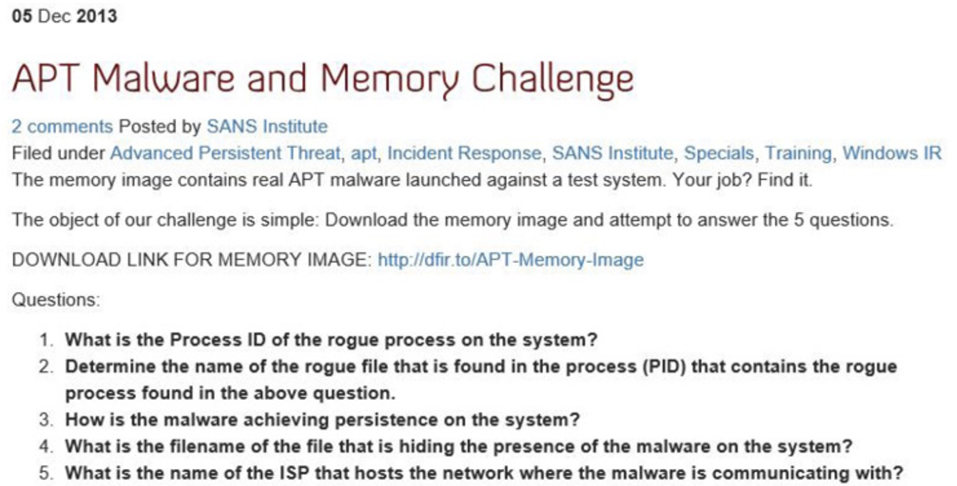
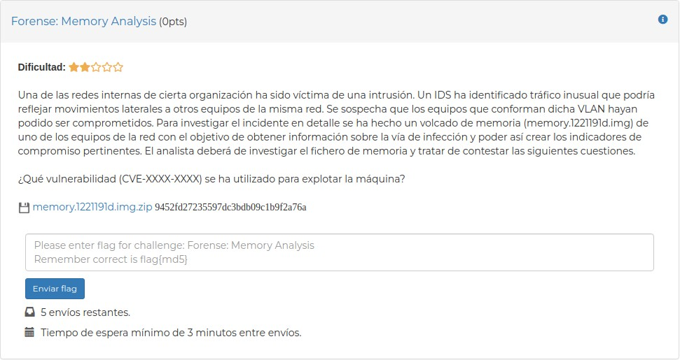

# RQ2: Plugin selection accuracy

**Research question.** How accurately does the server map natural-language
forensic questions to the correct Volatility 3 plugin?

This study evaluates the **forensic-aware docstring layer** of the server in
isolation. Unlike RQ1, there is no cross-server comparison here: RQ2 probes
how well the server's tool surface (the per-plugin docstrings) communicates
intent to the model, so that a natural-language question is routed to the
plugin a human analyst would have chosen.

## Benchmark

A 110-pair multilingual benchmark built from archived digital-forensics and
Capture-the-Flag (CTF) challenges. Each pair is one natural-language question
and the single Volatility 3 plugin that answers it. Ground truth comes from
the human-authored winning write-ups for each challenge: the plugin the
write-up used is recorded as the gold answer.

The benchmark is multilingual, drawn from international CTF and forensics
sources (English, Korean, Spanish, and others). The dataset ships as
`rq2.csv` with one row per pair:

| Column | Meaning |
|---|---|
| `id` | row identifier (1..110) |
| `ctf` | source challenge / event |
| `language` | question language (ISO code, e.g. `en`, `ko`, `es`) |
| `question` | the natural-language question, in its original language |
| `acceptable_tool` | gold plugin (the top-1 ground truth) |
| `image` | memory image the challenge uses |
| `link` | source write-up / challenge URL(s) |

A `[derived]` tag at the end of a `question` marks a question we derived from
a sample or tutorial write-up rather than quoting an original competition
prompt; the gold plugin still comes from the documented solution.

A `[translated]` tag marks a question presented in a language other than the
challenge's original publication language, either because the archived copy we
sourced it from was in that language or to broaden language coverage; the gold
plugin is unchanged. A question may carry both tags.

Language breakdown: English 64, Arabic 15, Korean 13, Chinese 9, Japanese 7,
Spanish 2, for 110 questions in total.

**Encoding.** Because questions are kept in their original languages (English,
Arabic, Korean, Spanish, Chinese, Japanese, and others), `rq2.csv` is saved as
**UTF-8 with a BOM**. Most tools
(pandas, R, and Excel) detect this automatically and show the multilingual
text correctly. When reading with Python's built-in `csv` module, open the
file with `encoding='utf-8-sig'` so the byte-order mark is stripped rather
than glued onto the first column name. If non-Latin text ever looks garbled,
the reader is interpreting the file under a non-UTF-8 locale (a common Excel
default): re-open it as UTF-8 and the original-language characters render
correctly.

The memory images are not bundled here due to their size; each row's `link`
points to the source challenge and its human-authored write-up for reference.

## Example entries

Two challenges illustrate the kind of questions in the benchmark and its
multilingual nature, one in English and one in Spanish.

**English.** The "APT Malware and Memory Challenge" from the **SANS
Institute** asks investigative questions over a single memory image: the PID
of the rogue process, how the malware persists, which file hides its
presence, and which provider hosts its command-and-control. Questions like
these map to plugins such as `pslist`/`malfind` (the rogue process),
`svcscan` (persistence), and `netscan` (network endpoints).



**Spanish.** The "Forense: Memory Analysis" task from the **CCN-CERT ATENEA**
competition asks which vulnerability (`CVE-XXXX-XXXX`) was used to exploit the
machine. The winning write-up answers it via the process command lines, so
this row's gold plugin (`acceptable_tool`) is `cmdline` (it is row `id=1` in
`rq2.csv`).



The benchmark collects 110 such question-and-answer pairs, each kept in its
original language and labelled with the single Volatility 3 plugin that a
human analyst used to solve it in the published write-up.

## Metric

Top-1 accuracy across the server's 88 candidate Windows plugins. A trial is
counted correct when the server's **first** plugin invocation for a question
equals that row's `acceptable_tool`. The chance baseline is therefore
1/88 = 1.1%.

## Results

| Configuration | Accuracy | 95% CI |
|---|---|---|
| Initial docstrings | 81.8% (90/110) | 73.6% - 87.9% |
| + Windows-version-aware semantics | 91.8% (101/110) | 85.2% - 95.6% |

Both far exceed the 1.1% chance baseline. The jump from 81.8% to 91.8% comes
from the Windows-version-aware plugin selection described in the paper
(Section 4.5): without it, the model would invoke a version-incompatible
plugin, get an empty result, and silently reroute to an adjacent sibling
plugin; version-aware semantics steer it to the plugin valid for the image's
Windows build.

The remaining failures were questions requiring auxiliary tools beyond
Volatility 3, which no single Volatility plugin can answer.

## Files

```
rq2.md          this file
rq2.csv         the 110-pair benchmark (id, ctf, language, question, gold plugin, image, link)
example_en.png  example screenshot (SANS APT Malware and Memory Challenge, English)
example_es.jpg  example screenshot (CCN-CERT ATENEA, Spanish; CSV row id=1)
```

## Reproduce

The benchmark is run against the server (not the baselines). For each row:
attach the server to the model with the row's `image` bound, ask the
`question` verbatim, and record the first plugin the server invokes. Score it
as correct when that first invocation equals `acceptable_tool`. Aggregate
top-1 accuracy over all rows; compute the 95% confidence interval with the
Wilson method. Re-run with and without the Windows-version-aware feature to
reproduce the two rows of the results table.
