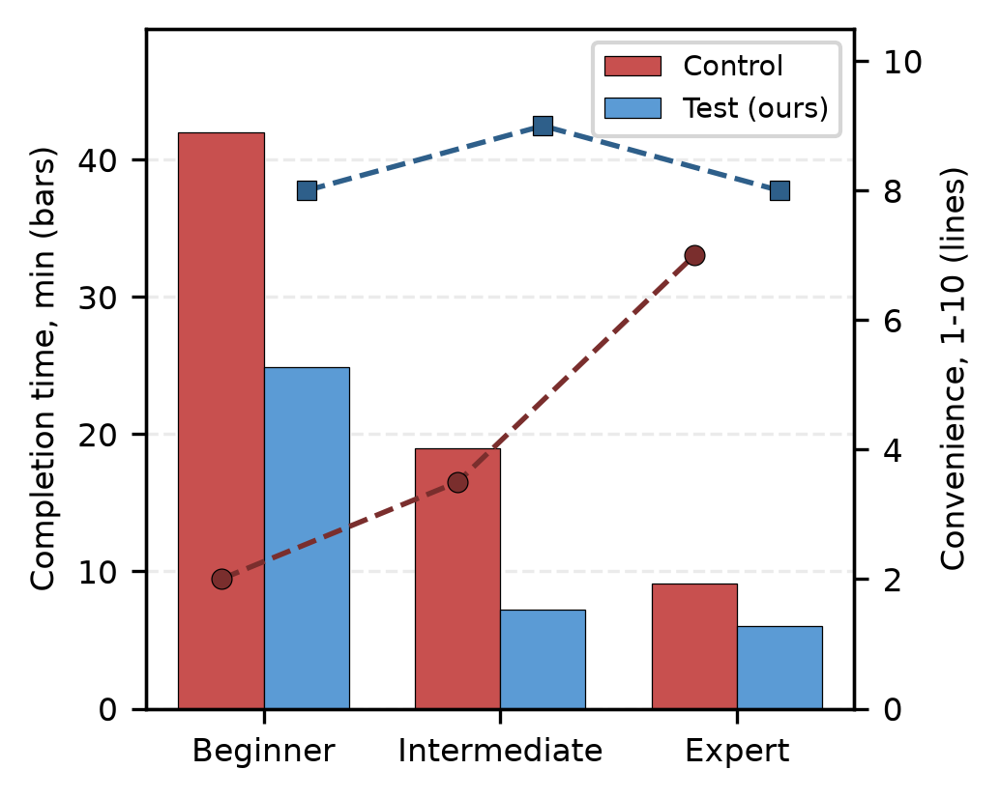

# RQ3: Usability for non-expert analysts

**Research question.** Does the server let non-expert analysts produce
expert-grade forensic findings faster and with less effort than the bare
Volatility 3 tooling?

This is a pilot user study. It compares a **test group** that analyzes a
memory image through our server in Claude Desktop against a **control group**
restricted to traditional tooling (Volatility 3 plugins, the `volshell` CLI,
and open-web search).

## Study design

Thirty-two participants were recruited from active police cyber investigators,
digital-forensics graduate students, and forensic-tool developers. Based on
their experience they were split into three proficiency levels (sixteen
beginners, twelve intermediates, four experts) and then divided evenly into the
two groups, so each group held 8 beginners, 6 intermediates, and 2 experts.

Each participant analyzed a 4 GB Windows 7 memory image infected with one of
six ransomware families (GandCrab, WannaCry, HASTATI, BlackMatter, Gunra,
DoNex) and answered a questionnaire of multiple-choice and short-answer
questions. We recorded the total time from first seeing the questions to
submitting answers, and a convenience rating on a 10-point Likert scale.

The six ransomware samples (one per family) are identified by the SHA-256 of
their executable:

| Ransomware family | File name | Sample (.exe) SHA-256 |
|---|---|---|
| GandCrab | `gandcrap_v5.exe` | `d77378dcc42b912e514d3bd4466cdda050dda9b57799a6c97f70e8489dd8c8d0` |
| WannaCry | `lhdfrgui.exe` | `6bf1839a7e72a92a2bb18fbedf1873e4892b00ea4b122e48ae80fac5048db1a7` |
| HASTATI | `vl.exe` | `74bc952195207c79472c85eae059280307b1b8b6ebf722b49e7d43bf4f316a72` |
| BlackMatter | `b70e78971fc44f.exe` | `b70e78971fc44f8413447139afe777f19fd1b0d203f2d40f66f41cd6100a1c95` |
| Gunra | `packed.exe` | `a82e496b7b5279cb6b93393ec167dd3f50aff1557366784b25f9e51cb23689d9` |
| DoNex | `donex.exe` | `0adde4246aaa9fb3964d1d6cf3c29b1b13074015b250eb8e5591339f92e1e3ca` |

## Questionnaire

Each participant answered the same 10-item questionnaire on their assigned
ransomware-infected image. The items are adapted from the kinds of questions
in the RQ2 benchmark and pitched to be slightly challenging for a beginner:
each one requires choosing the right Volatility 3 plugin and interpreting its
output rather than reading off a single value. The questionnaire mixes
multiple-choice and short-answer items; the multiple-choice ones are phrased
as "Which of the following ..." and their answer options are omitted here, so
only the question prompts are listed.

1. Which of the following correctly gives the name and PID of the process
   carrying out the ransomware's file-encryption activity?
2. The malicious process was not started directly by the user. Identify its
   parent process and explain why the parent-child relationship is suspicious.
3. Recover the full command line, including any script path or arguments,
   used to launch the malicious process.
4. Which of the following is the remote IP address and port that the malware
   used for command-and-control communication?
5. One process contains injected or hidden executable code. Identify that
   process and the virtual address of the injected region.
6. Determine how the ransomware achieves persistence across reboots (for
   example, the registry Run-key value or the service it installed).
7. Locate the ransom note or the dropped malicious executable and give its
   full file path on disk.
8. Which of the following is the NTLM password hash of the local Administrator
   account recovered from the image?
9. Identify a DLL loaded into the malicious process that does not belong to a
   normal Windows installation.
10. Which of the following is a host-based indicator of compromise specific to
    this ransomware family (for example, an appended file extension or a
    unique mutex)?

## Data

`rq3.csv` contains the final collected study data, with one row per participant
(32 participants, 16 per group):

| Column | Meaning |
|---|---|
| `participant_id` | P01..P32 |
| `name`, `affiliation`, `email` | personal data, **blinded** |
| `experience_years` | years of forensic experience; the basis for the proficiency level |
| `group` | `test` (our server) or `control` (traditional tooling) |
| `proficiency` | `beginner` (0-3 yr), `intermediate` (6-7 yr), or `expert` (10-11 yr) |
| `ransomware_family` | the family infecting that participant's image |
| `completion_time_min` | total task time in minutes |
| `convenience_score` | 10-point Likert convenience rating |

The identifying columns (`name`, `affiliation`, `email`) are recorded as
`blinded` for double-blind review and to protect the participants' personal
data. Years of experience are retained because they motivate the three
proficiency levels, whose non-overlapping bands (0-3, 6-7, 10-11 years) are
also balanced across the two groups.

## Results



Per-tier **average** completion time and convenience (the values plotted
above; cohort weights: 8 beginners, 6 intermediates, 2 experts per group):

| Proficiency | Avg. time, control (min) | Avg. time, test (min) | Avg. convenience, control | Avg. convenience, test |
|---|---|---|---|---|
| Beginner | 42.0 | 24.9 | 2.0 | 8.0 |
| Intermediate | 19.0 | 7.2 | 3.5 | 9.0 |
| Expert | 9.1 | 6.0 | 7.0 | 8.0 |
| **Overall (weighted avg.)** | **29.3** | **15.9** | **3.2** | **8.4** |

The test group completed the task in **15.9** minutes on average versus
**29.3** minutes for the control group: a **45.7% reduction** in completion
time (a **1.84x** speedup). Beginners achieved the largest time savings
(42.0 to 24.9 minutes), while experts, already fast with the raw tooling,
saved 3.1 minutes (9.1 to 6.0 minutes).

The MCP workflow received an average convenience score of **8.4 / 10**,
against **3.2 / 10** for the control group. Intermediate-level participants
rated it highest at **9.0 / 10**. These results are preliminary given the
small sample, but they indicate the structured tool surface shortens analysis
time most for less-experienced investigators.

The reduction and speedup use the unrounded participant-level means
(29.2625 and 15.9 minutes). Overall means weight each participant equally.
The CSV records time and convenience but no answer-quality scores, so these
results alone do not establish expert-grade report quality. Ransomware family
also varies with proficiency in this dataset, which limits comparisons
between proficiency tiers. No statistical significance is claimed.

## Files

```
rq3.md            this file
rq3.csv           per-participant pilot-study data (time, convenience; identifiers blinded)
plot_usability_expanded.py reads rq3.csv and renders the figure
usability.png     the rendered figure (output of plot_usability_expanded.py)
```

## Reproduce

From the VolPilot project root:

```bash
uv run --with matplotlib python evaluation/rq3/plot_usability_expanded.py
```

The script aggregates `rq3.csv` by proficiency level and group, prints the
overall per-group means (control 29.3 min / 3.2; test 15.9 min / 8.4), and
writes `usability.png`.
